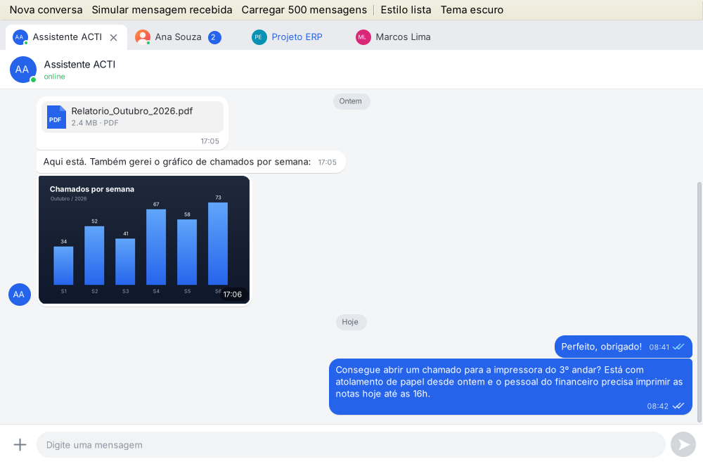
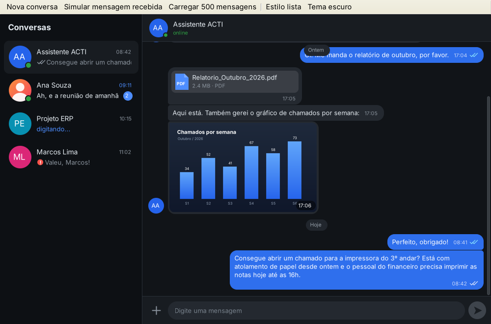
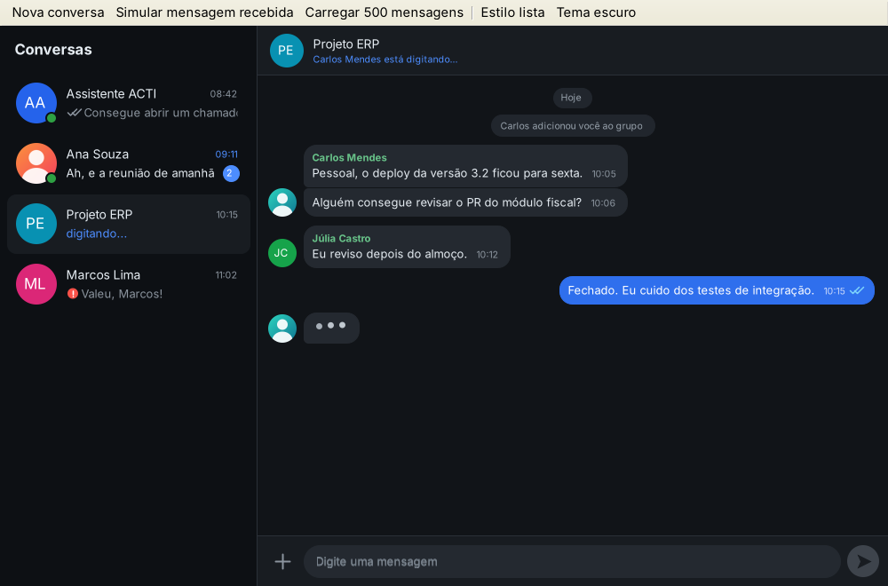
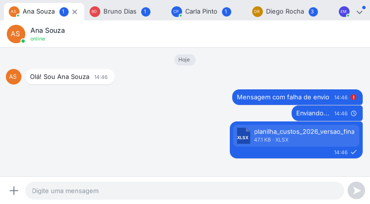
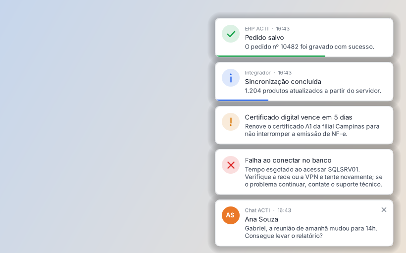
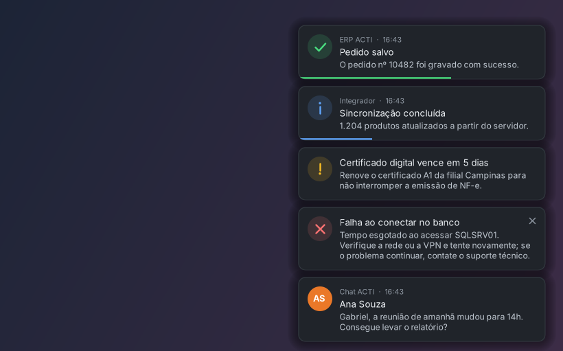
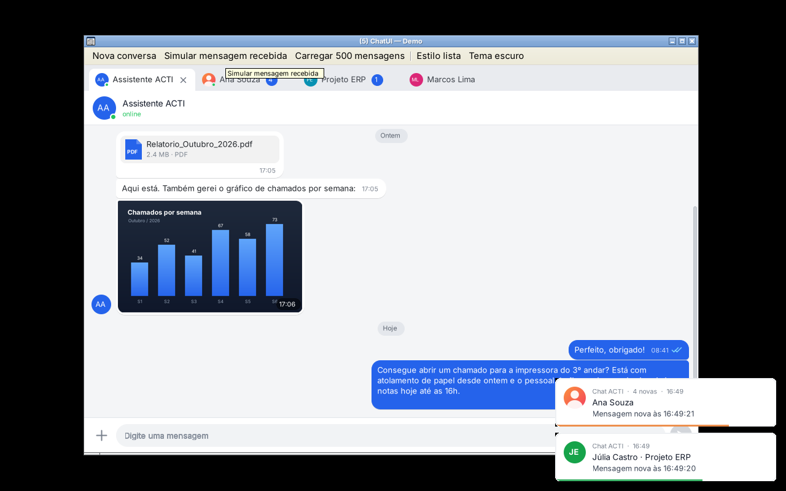

# ChatUI + ToastUI — componentes para WinForms (.NET Framework 4.5.1, VB.NET)

Duas DLLs independentes:

- **ChatUI.dll** — componente de chat (abaixo).
- **ToastUI.dll** — notificações flutuantes genéricas, para qualquer sistema ([ir para a seção](#toastui--notificações)).

---

## ChatUI

Componente de chat **nativo**: tudo é desenhado com GDI/GDI+ (balões, avatares, abas, botões),
sem WebBrowser, sem WPF e sem dependências externas. Gera uma única DLL (`ChatUI.dll`).

| Abas (tema claro) | Lista de conversas (tema escuro) |
|---|---|
|  |  |
|  |  |

## O que tem

- **Balões** com quebra de linha, agrupamento de mensagens seguidas, cantos arredondados por grupo, hora e **status**
  (relógio, ✓, ✓✓, ✓✓ lida, ! falha — clicável para reenviar).
- **Separadores de data** (Hoje / Ontem / dia da semana / data) e data "grudada" no topo ao rolar.
- **Avatares** com foto (recorte circular com antialias) ou iniciais com cor automática; bolinha de online.
- **Imagens** no balão (miniatura em cache, legenda opcional, visualizador ao clicar) e **anexos** (cartão com ícone,
  nome, tamanho; abre o arquivo ao clicar).
- **"Digitando..."** animado na conversa, no cabeçalho e na aba.
- **Caixa de digitação**: Enter envia, Shift+Enter quebra linha, cresce até 5 linhas, placeholder, botão de anexo,
  **Ctrl+V de imagem**, **arrastar e soltar arquivos**.
- **Abas** (`ChatTabs`): estilo *Tabs* (navegador, com X e menu de abas excedentes) ou *List* (WhatsApp/Teams, com
  prévia da última mensagem, hora e não lidas). Ctrl+Tab, Ctrl+Shift+Tab, Ctrl+W, clique do meio fecha.
  Rascunho e posição de rolagem são guardados por conversa.
- **Virtualizado**: só desenha o que está na tela; medições de texto ficam em cache (2.000 mensagens sem travar).
- Rolagem suave, barra de rolagem fina desenhada, botão "ir para o fim" com contador de novas mensagens.
- Histórico sob demanda: evento `LoadOlderRequested` ao chegar no topo; `InsertRange(0, ...)` mantém a posição.
- Temas claro/escuro (`ChatTheme`), todas as cores/fontes editáveis no designer. Textos traduzíveis (`ChatStrings`).
- Suporte a DPI (escala calculada pelo DPI da tela).

## Estrutura

```
ChatUI.sln
src/ToastUI/                    → a DLL de notificações (ver seção ToastUI)
samples/ToastUI.Demo/           → demo das notificações em vários cenários
src/ChatUI/                     → a DLL do chat
  Model/      ChatUser, ChatMessage (+ChatAttachment), ChatConversation, coleções observáveis
  Theme/      ChatTheme (cores, fontes, medidas) e ChatStrings (textos)
  Rendering/  GdiHelpers (retângulo arredondado, avatar, ícones de status, etc.)
  Controls/   ChatView, ChatComposer, ChatHeader, ChatBox, ChatTabs (+ChatTabStrip, ChatImageViewer)
samples/ChatUI.Demo/            → app de demonstração (bot que responde, grupo, imagens, anexos)
bin/                            → DLLs e demos já compiladas (para testar rápido)
```

## Como compilar

1. Abra `ChatUI.sln` no Visual Studio 2013 ou superior (o código usa só recursos do VB 12).
2. `F5` roda a demo. A DLL sai em `src/ChatUI/bin/Release/ChatUI.dll` (com `ChatUI.xml` para o IntelliSense).

## Usando no seu projeto

Referencie `ChatUI.dll` (ou o projeto `ChatUI.vbproj`). Para arrastar pela Toolbox: clique direito na Toolbox →
*Choose Items...* → *Browse* → `ChatUI.dll`. Aparecem `ChatTabs`, `ChatBox`, `ChatView`, `ChatComposer` e `ChatHeader`.

```vb
Imports ChatUI

Public Class Form1
    Private ReadOnly _eu As New ChatUser("123", "Gabriel")

    Private Sub Form1_Load(sender As Object, e As EventArgs) Handles MyBase.Load
        ChatTabs1.CurrentUser = _eu
        ChatTabs1.TabStyle = ChatTabStyle.List        ' ou ChatTabStyle.Tabs

        Dim ana As New ChatUser("ana", "Ana Souza") With {.IsOnline = True}
        Dim conversa = ChatTabs1.AddConversation(ana)
        conversa.AddIncoming("Oi! Tudo bem?")
    End Sub

    ' O usuário enviou algo: a mensagem já aparece com o reloginho (Sending).
    Private Sub ChatTabs1_MessageSubmitted(sender As Object, e As ChatMessageSubmittedEventArgs) Handles ChatTabs1.MessageSubmitted
        MeuServidor.Enviar(e.Conversation.Id, e.Message.Id, e.Message.Text)   ' seu backend
    End Sub

    ' Chegou confirmação/resposta do servidor (normalmente em outra thread):
    Private Sub Servidor_Evento(conversaId As String, msgId As String, texto As String)
        BeginInvoke(Sub()
                        Dim conv = ChatTabs1.Conversations.FindById(conversaId)
                        If conv Is Nothing Then Return
                        Dim enviada = conv.Messages.FindById(msgId)
                        If enviada IsNot Nothing Then enviada.Status = MessageStatus.Read   ' ✓✓ azul
                        If texto IsNot Nothing Then conv.AddIncoming(texto)            ' nova mensagem
                    End Sub)
    End Sub
End Class
```

Outras coisas úteis:

```vb
conversa.IsTyping = True                       ' mostra "digitando..."
conversa.IsGroup = True : conversa.TypingUser = carlos   ' grupo: nome em cima dos balões
conversa.Messages.AddRange(historico)          ' carrega muitas de uma vez (um único redesenho)
conversa.Messages.InsertRange(0, antigas)      ' "carregar anteriores" sem pular a tela
ChatTabs1.Theme.ApplyDark()                    ' tema escuro; ou mude cores uma a uma
ChatTabs1.ChatBox.SendFile("C:\nota.pdf")      ' enviar por código
ChatStrings.Placeholder = "Escreva aqui..."    ' textos
AddHandler ChatTabs1.ChatBox.AttachRequested, Sub(s, a)               ' trocar o comportamento padrão
                                                  a.Handled = True
                                                  AbrirMeuDialogo()
                                              End Sub
```

Só uma conversa, sem abas? Use `ChatBox` e defina `ChatBox1.Conversation = New ChatConversation(contato)`.
Precisa só da área de mensagens? `ChatView` funciona sozinho.

## Principais eventos

| Controle | Evento | Quando |
|---|---|---|
| ChatTabs / ChatBox | `MessageSubmitted` | Usuário enviou (texto, imagem colada, arquivo). Atualize `e.Message.Status`. |
| ChatBox | `MessageSubmitting` | Antes de criar a mensagem (pode alterar o texto ou cancelar). |
| ChatTabs | `MessageReceived` | Mensagem recebida em qualquer aba (para notificar/piscar a janela). |
| ChatTabs | `SelectedConversationChanged`, `ConversationClosing`, `ConversationClosed` | Abas. |
| ChatTabs / ChatBox | `TypingStateChanged` | O usuário local começou/parou de digitar (envie "digitando" ao outro lado). |
| ChatBox | `AttachRequested`, `FilesDropped`, `ImagePasted` | Têm comportamento padrão; `e.Handled = True` substitui. |
| ChatBox / ChatView | `MessageClick`, `ImageClick`, `AttachmentClick`, `RetryRequested`, `MessageContextMenuOpening`, `LoadOlderRequested` | Interação com as mensagens. |

## Observações

- Altere conversas/mensagens pela thread da UI. Os controles se protegem com `BeginInvoke`, mas a coleção em si
  não é thread-safe — use `BeginInvoke` como no exemplo acima.
- Emojis aparecem monocromáticos (limitação do GDI/TextRenderer, que o .NET 4.5.1 usa).
- Não há seleção parcial de texto dentro do balão; o menu de contexto tem "Copiar texto" / "Copiar imagem".
- GIF animado mostra só o primeiro quadro.

---

## ToastUI — notificações

Notificações flutuantes desenhadas com GDI+. **Não** usam a Central de Notificações do Windows e **não** são janelas
do seu formulário: cada uma é uma janelinha própria, sempre por cima, fora da barra de tarefas e do Alt+Tab, que
**não rouba o foco** de quem está digitando. Não dependem do ChatUI — servem para qualquer sistema.

| Tema claro (mouse sobre a última: X aparece) | Tema escuro |
|---|---|
|  |  |

- **Dispensar**: arrastar para o lado (solta antes do meio e ela volta), botão **X** (aparece ao passar o mouse) ou
  **some sozinha** após o tempo, com barrinha de tempo restante. O tempo **pausa** com o mouse em cima.
- **Tipos prontos**: `Info`, `Success`, `Warning`, `Error`, `Message` (avatar com foto ou iniciais) e `Plain`;
  ou sua própria imagem e cor.
- **Empilhamento** animado no canto (inferior direito por padrão; os 4 cantos), fila quando passa de `MaxVisible`.
- **Atualizável**: mude `Title`/`Message`/`Type` de uma notificação aberta e ela se redesenha (ex.: progresso).
- **Thread-safe**: `Show` pode ser chamado de qualquer thread (callback de socket, timer etc.).
- No Windows usa *layered window* (transparência por pixel): cantos suaves e sombra de verdade.
- Temas claro/escuro (`ToastTheme.FromSystem()` segue o modo do Windows 10/11), som opcional, DPI.

### Uso

```vb
Imports ToastUI

' o jeito mais curto
ToastManager.Default.ShowSuccess("Cliente salvo", "Os dados foram gravados.")
ToastManager.Default.ShowError("Falha ao conectar", "Servidor SQLSRV01 não respondeu.")

' com mais controle
Dim t As New Toast("Falha ao emitir NF-e", "Rejeição 539. Clique para ver os detalhes.", ToastType.Error) With {
    .Duration = 0,                ' 0 = fica até o usuário fechar
    .Caption = "Fiscal",          ' linha pequena acima do título
    .Tag = notaId}                ' qualquer objeto seu
AddHandler t.Click, Sub(s, e) AbrirNota(CInt(e.Toast.Tag))
AddHandler t.Closed, Sub(s, e) Debug.Print(e.Reason.ToString())   ' Timeout, CloseButton, Swiped, Clicked, Programmatic
ToastManager.Default.Show(t)

' atualizar uma notificação aberta
t.Message = "Reenviando..." : t.Type = ToastType.Info
t.Close()                         ' fechar por código
```

Você também pode arrastar um **ToastManager** da Toolbox para o form (é um componente, fica na bandeja do designer)
e configurar no Properties: `Position`, `DefaultDuration`, `MaxVisible`, `PauseOnHover`, `CloseOnClick`,
`AllowSwipe`, `PlaySounds`, `AppCaption`, `Theme`. Eventos: `ToastShown`, `ToastClicked`, `ToastClosed`.

Exemplo com o chat (em `samples/ChatUI.Demo`): quando chega mensagem numa conversa que não está aberta, aparece uma
notificação com o avatar; mensagens seguidas da mesma conversa atualizam a mesma notificação; clicar traz a janela
para frente e abre a conversa.



### Observações

- As notificações vivem no processo do seu programa: se o programa fechar, elas fecham junto.
- Na primeira vez, use o `ToastManager` pela thread da interface (ex.: no `Load` do form); depois, qualquer thread.
- Sem foco: a janela é criada com `WS_EX_NOACTIVATE` e responde `MA_NOACTIVATE` ao clique; por segurança, se
  mesmo assim virar a janela ativa, o foco é devolvido. Clicar numa notificação também não tira o foco do seu
  formulário — no evento `Click` chame `Activate()` no form se quiser trazê-lo para frente.
